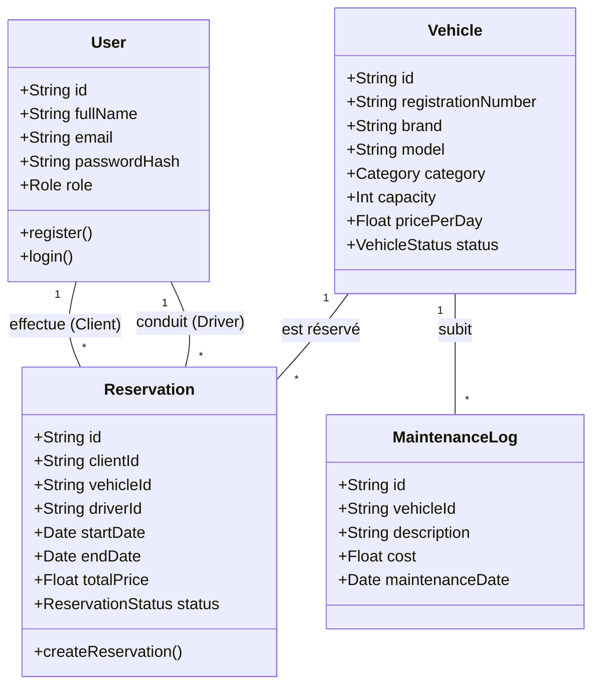
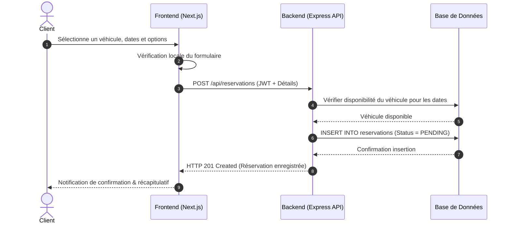

# Diagrammes UML – Conception du Projet

**Projet :** Plateforme de Réservation en Ligne & Gestion de Flotte (Tourisme & Transport)  
**Auteur :** ANJARANIAINA IDEALIPITIA Andry Andraina Lucas  

---

## 1. Diagramme des Cas d'Utilisation (Use Case Diagram)

```mermaid
usecaseDiagram
    actor "Touriste / Visiteur" as Visitor
    actor "Client Authentifié" as Client
    actor "Gestionnaire / Admin" as Admin

    package "Plateforme Tourisme & Gestion de Flotte" {
        usecase "Consulter les véhicules & circuits" as UC_Search
        usecase "S'authentifier" as UC_Auth
        usecase "Réserver un véhicule / circuit" as UC_Book
        usecase "Consulter mes réservations" as UC_MyBookings
        usecase "Gérer le parc de véhicules (CRUD)" as UC_Manage_Fleet
        usecase "Traiter & Valider les réservations" as UC_Manage_Bookings
        usecase "Affecter les chauffeurs" as UC_Assign_Driver
        usecase "Suivre la maintenance des véhicules" as UC_Maintenance
    }

    Visitor --> UC_Search
    Visitor --> UC_Auth

    Client --|> Visitor
    Client --> UC_Book
    Client --> UC_MyBookings

    Admin --> UC_Manage_Fleet
    Admin --> UC_Manage_Bookings
    Admin --> UC_Assign_Driver
    Admin --> UC_Maintenance
```

---

## 2. Diagramme de Classes (MCD)



---

## 3. Diagramme de Séquence (Effectuer une Réservation de Véhicule)

